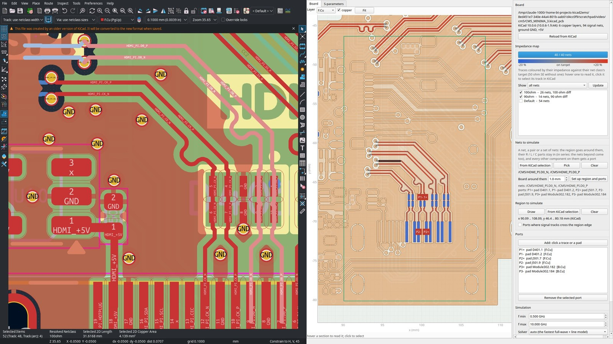
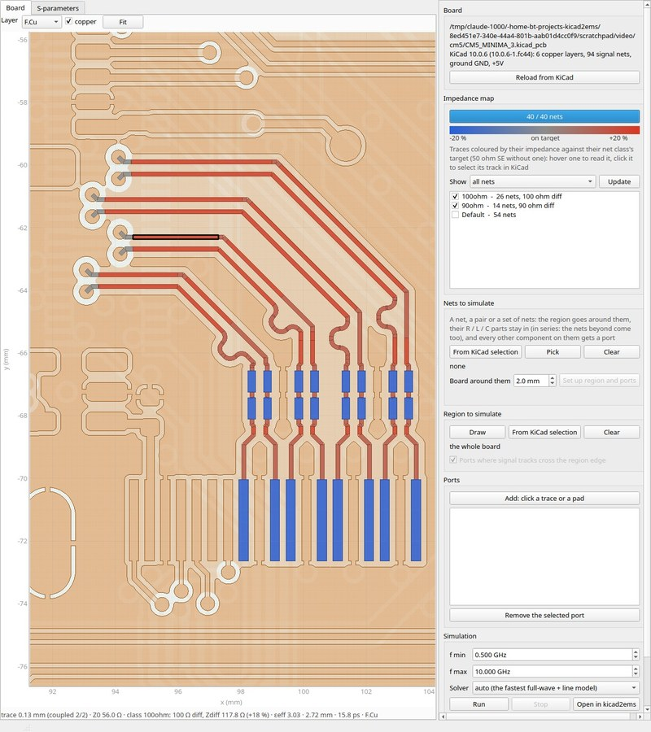
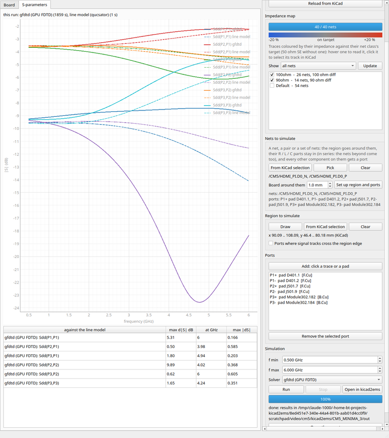

# kicad2ems-ipc

[kicad2ems](https://github.com/lowprocess/kicad2ems)'s plugin for KiCad's PCB editor. It talks to KiCad through
KiCad's IPC API (KiCad 9 and later) and reads the board as it is open in KiCad, unsaved edits included.



A toolbar button opens a window with:

- **The impedance map:** every trace coloured by how far its impedance is from its net class's target
  ([line model](https://github.com/lowprocess/kicad2ems/blob/main/docs/transmission-lines.md) Z0, or Zdiff for a
  pair; blue below, grey on target, red above). Hover a trace to read its cross-section, width, Z0, Zdiff, class,
  target and deviation; click it to select its track in KiCad.
- **Nets to simulate:** a net, a pair or a set of nets, picked on the map or taken from KiCad's selection; their
  region, ports and parts are set up from the board ([Simulating nets](#simulating-nets)).
- **A region and ports:** two clicks on the plan or the box around KiCad's selection, optionally with ports where
  signal tracks cross its edge; ports clicked on traces and pads, beside the board's own port footprints (Fab
  text `P<n>`).
- **A simulation:** the band and the solver, then Run (progress and the report in the window), or Open in kicad2ems
  (the same set-up in [kicad2ems's own window](https://github.com/lowprocess/kicad2ems/blob/main/docs/gui.md)). The
  S-parameters tab shows the results against the line model.

<p align="center">
  
  
  
</p>

*KiCad's CM5 Minima demo: the map of its 94 signal nets filling in; its HDMI pairs against their 100 ohm class,
one section read out at the bottom; the D0 pair's mixed-mode S-parameters from gfdtd (solid) and the line model
(dashed).*

## Installing

**From KiCad's Plugin and Content Manager** (KiCad 9.0.1 or later): install *kicad2ems*, then Preferences >
Plugins > **Enable KiCad API** and restart KiCad. The kicad2ems button appears in the PCB editor's toolbar. Its
first press builds the plugin its own Python environment with kicad2ems in it (`plugin/requirements.txt`): a few
minutes, once (Preferences > Plugins > Recreate Plugin Environment does it again). On Linux KiCad uses the first
Python on the PATH; on Windows and macOS its own.

**From this repository**:

```bash
python plugin/kicad2ems_plugin.py install           # copies plugin/ into KiCad's plugins folder
python plugin/kicad2ems_plugin.py install --exec    # or: run this checkout with this Python
python plugin/kicad2ems_plugin.py uninstall
```

`install` writes a folder `kicad2ems` into the plugins folder of every KiCad 9 or later found
(`~/.local/share/kicad/<version>/plugins` on Linux, `Documents/KiCad/<version>/plugins` on Windows and macOS);
`--kicad-version 10.0` picks one and `--dir` gives the folder itself. With `--exec` KiCad runs the checkout's entry
point with the Python that ran `install` and builds no environment: for working on the plugin, or for a kicad2ems
you have installed already (with openEMS, mom25d's compiled core or a GPU wheel). That Python needs
`pip install -r plugin/requirements.txt`.

**Solvers.** The environment KiCad builds has the line model and gfdtd (on the CPU). mom25d and openEMS are not in
it (mom25d's mesher has no wheel for every Python, and openEMS is not on PyPI): install the plugin with `--exec`
from a Python that has them, or install them into the plugin's environment
(`<KiCad's cache folder>/python-environments/org.kicad2ems.plugin`).

| File | |
|---|---|
| `plugin.json` | One action in the PCB editor, runtime `python` (`exec` with `--exec`) |
| `kicad2ems_plugin.py` | The entry point. KiCad passes it its API socket and token |
| `requirements.txt` | What KiCad installs into the plugin's environment |
| `kicad2ems_ipc/` | The plugin |
| `icon-24.png`, `icon-48.png` | The button |

## Using it

1. Open the board in KiCad's PCB editor and press the kicad2ems button. The map fills in as the nets are read.
2. Read the map: the layer box switches copper layers. Hover a trace for its numbers; click it to find it in
   KiCad.
3. Set a region: **Draw** and click two corners, or select the parts of interest in KiCad and press **From KiCad
   selection**. Tick **Ports where signal tracks cross the region edge** to terminate the lines the edge cuts.
4. Add ports: **Add**, then click traces or pads (on the layer shown). Ports outside the region are left out.
5. Set the band and the solver, and **Run** (on the board as KiCad has it at that moment), or **Open in
   kicad2ems** for every setting, the plots and the field views.

**Reload from KiCad** reads the board again after edits. The region, ports, band and solver are kept per board.

### Simulating nets

1. Pick the nets: **From KiCad selection** takes the nets of what is selected in KiCad; **Pick** adds the net of
   each trace you click (again to remove it). A pair's other leg always comes along.
2. Set **Board around them** (2 mm by default: enough for the planes and ground beside the lines) and press
   **Set up region and ports**. This sets:
   - **The nets:** the ones picked, plus the net on the far side of each series R / L / C, and so on (up to 16).
   - **The parts:** two-pad R / L / C footprints whose value kicad2ems reads (not DNP): to ground a shunt part,
     between two of the nets a series part. A part to a supply (`#PWR`) or an unconnected pad is left out.
   - **The ports:** one on the pad of every other footprint on the nets (ICs, connectors, ESD parts), and one at
     each track end that reaches no pad, via or track. A footprint with pads on both legs of a pair, or two legs'
     open ends within 3 mm, make one differential port (`P1+` / `P1-`). Nets with port footprints keep those.
   - **The region:** the box around the nets' copper and their parts' pads, plus the margin.
3. **Run** models only these nets and the ground nets, and solves the line model too, as the reference.
4. The **S-parameters** tab: |S| in dB of each full-wave solver (solid) and of the line model (dashed), the
   differential terms (Sdd) for a pair. The table gives each term's largest difference in dB (where the
   full-wave |S| is above -20 dB) and its largest complex difference |dS|.

A region drawn or taken from the selection turns a net run back into an ordinary run; a port clicked by hand adds
its net to the run.

On the `rf_diffvia` example without its port footprints, picking `D_P` sets up the pair as `P1±` at the open ends
on F.Cu and `P2±` on In2.Cu; with gfdtd, Sdd21 matches the coupled line model within 0.27 dB from 0.5 to 6 GHz
(46 s on an RX 7800 XT). On `demo_lowpass`, picking `RF_IN` brings in `N1` and `RF_OUT` through L1 and L3, and
keeps C2 as a shunt part.

### Net classes and impedance targets

The target comes from the net class's name: a number with `ohm`, `Ohm`, `R` or `Ω` after it (or `Z` before it),
and `SE` / `single` or `diff` / `DP` / `differential` for the kind:

| Class name | Target |
|---|---|
| `50R_SE`, `50 Ohm SE`, `Z50_SE` | 50 Ω single-ended |
| `100R_DIFF`, `100ohm_diff`, `Z90_DP` | 100 / 90 Ω differential |
| `90ohm`, `100ohm` (no kind, as KiCad's CM5 demo names them) | differential if the class holds a pair, else single-ended |
| `Default`, `DDR4`, `HS` | none: judged against 50 Ω single-ended |

A pair is two nets whose names end in `+` / `-` or `P` / `N` (KiCad's rule); in a differential class a net that is
not a pair's leg gets no target. KiCad reports the classes through its API; without it the plugin reads the
`.kicad_pro`. Anything named `#PWR` (a net or a class) is never mapped.

A differential target is checked against the pair's Zdiff where the legs run side by side (2 Zodd, from the
coupled-line model), and against 2 Z0 where they part. The colours run from -x % to +x % of the target, x covering
95 % of the traces shown (at least 10 %).

A pair's Zdiff and a grounded CPW's Z0 include the copper's thickness, from the field solver, so a pair designed by
a zero-thickness formula reads low here: `rf_diffvia`'s "100 ohm" pair reads 92 ohm on the outer layers and 84 ohm
on the inner ones (3D FDTD agrees within 1 ohm). **Every section by the field solver** takes every trace from the
board's copper cut across it (about 5 x slower; both maps are kept). **Field across it…** draws the field across
the section last clicked. **Show** narrows the map to KiCad's selection or the region.

### Speed

The map is built a net (or a pair) at a time over worker processes (one per performance core), and kept: next
time, and after **Reload from KiCad**, only the nets whose copper changed are mapped again (a change of the planes
or the stack re-maps everything). On an i7-13700K (8 workers):

| KiCad demo | Signal nets | Mapped | From the cache |
|---|---|---|---|
| CM5 Minima | 94 | 0.8 s | 0.35 s |
| video | 369 | 2.7 s | 1.0 s |
| Jetson AGX Thor baseboard | 862 | 6.6 s | 4.2 s |

Past 150 signal nets the window starts with the classes that name an impedance (or KiCad's selection).

## Files

Everything goes to `<project>/kicad2ems/<board>/`:

| File | |
|---|---|
| `<board>_plugin.json` | The session: region, ports, cut ports, band, solver, the classes shown, the nets of a net run |
| `<board>_impedance.json.gz` | The map kept between sessions: each net's sections, under a hash of its copper and of the board's planes and stack |
| `<board>.kicad_pcb` | The board as KiCad had it at the last Run (the run's input) |
| `<board>.toml` | The run's kicad2ems config: `kicad2ems <board>.toml` repeats it, `kicad2ems-gui <board>.toml` opens it |
| `out/` | The run's results: S-parameters, plots, the report |

The config is plain kicad2ems: `region = [x0, y0, x1, y1]` (KiCad mm), `ports = ["P5@x,y,F.Cu", "P6=J1.1"]`
([extra ports](https://github.com/lowprocess/kicad2ems/blob/main/docs/model.md#extra-ports)), `cut_ports`,
`nets = ["auto"]` (a net run: its nets and the ground nets, and `fast = "auto"`), `fmin`, `fmax`, `solvers`.

## How it works

| Module | |
|---|---|
| `plugin/kicad2ems_ipc/ipc.py` | The link to KiCad (kipy): the board as text (`Board.get_as_string`), its path, the selection's box and nets, selecting a track |
| `plugin/kicad2ems_ipc/model.py` | No Qt: the board read by kicad2ems's KiCad importer from that text, the impedance map, ports snapped to traces and pads, the session, the run's settings |
| `plugin/kicad2ems_ipc/window.py` | The window: kicad2ems-gui's plan view with the region and port tools, the map built in a thread, runs as a separate process (the GUI's event stream) |
| `plugin/kicad2ems_ipc/install.py` | The plugin folder |

The map is the line model of every routed signal net, built without ports. The reference copper excludes every
signal net, so a trace is referenced to the planes and grounds, never to a neighbouring trace; only a pair's legs
couple, so the map does not depend on how the nets were grouped.

Not yet: writing the region or the ports back into the board, differential ports clicked by hand (a net run
makes them), clicking ports on layers other than the one shown, and footprint-editor or schematic actions.

## Releasing

```bash
python tools/build_pcm.py                 # dist/kicad2ems-<version>-pcm.zip and dist/metadata.json
```

Upload the zip to the GitHub release `v<version>` (`__version__` in `plugin/kicad2ems_ipc/__init__.py`), then
submit `dist/metadata.json` as `packages/com.github.lowprocess.kicad2ems/metadata.json` (with `pcm/icon.png`) in a
merge request to [gitlab.com/kicad/addons/metadata](https://gitlab.com/kicad/addons/metadata). Pin
`plugin/requirements.txt` to the kicad2ems and gfdtd commits the release was tested with.

## Developing

```bash
pip install -r plugin/requirements.txt pytest jsonschema
python -m pytest tests
```

The tests read three of kicad2ems's example boards (`tests/boards`). What the plugin uses of kicad2ems and
kicad2ems-gui is on kicad2ems's [APIs](https://github.com/lowprocess/kicad2ems/blob/main/docs/api.md) page.
